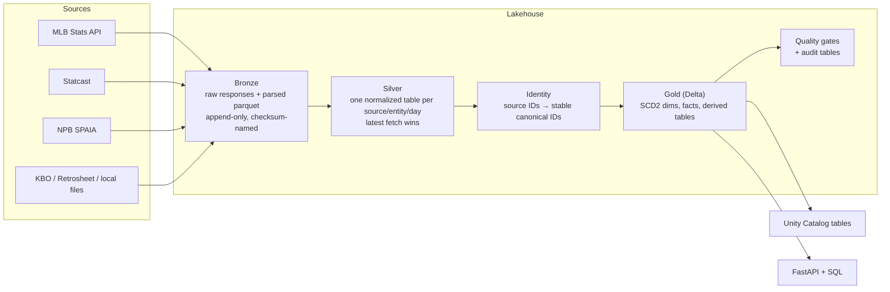

# Global Baseball Data Platform (GBDP)

A lakehouse that pulls MLB, NPB (Japan) and other leagues' data from their public feeds and turns it into one consistent, queryable model: games, rosters, players, every plate appearance and every pitch. It also produces derived analytics like season-to-date run expectancy. It runs nightly on Databricks (Delta Lake + Unity Catalog) and identically on a laptop (Parquet + DuckDB), and serves everything through a small FastAPI.

```
$ curl 'localhost:8000/run-expectancy?league=MLB&season=2026'
```

| Bases | 0 outs | 1 out | 2 outs |
|-------|-------:|------:|-------:|
| empty | 0.49 | 0.26 | 0.11 |
| 1st | 0.89 | 0.53 | 0.24 |
| 2nd | 1.14 | 0.67 | 0.34 |
| 3rd | 1.38 | 0.92 | 0.37 |
| 1st & 2nd | 1.52 | 0.87 | 0.45 |
| 1st & 3rd | 1.85 | 1.18 | 0.50 |
| 2nd & 3rd | 1.90 | 1.37 | 0.53 |
| loaded | 2.43 | 1.63 | 0.77 |

<sub>Expected runs from each base/out state to the end of the inning, from all 139,585 MLB plate appearances of 2026-05-13 to 11-05 in production gold, reconciled game by game against MLB's own box scores (see [Proving the data is right](#proving-the-data-is-right)).</sub>

## What's in it

| Source | League | What it provides |
|---|---|---|
| MLB Stats API | MLB | schedules, games and scores, rosters, transactions, player bios (height, weight, birth date, bats/throws) |
| Baseball Savant (Statcast) | MLB | every pitch: type, velocity, location, count, result; plate appearances and base/out state derived from it |
| SPAIA | NPB | schedules, games, rosters (with kana names), play-by-play, standings, player stats |
| KBO | KBO | games, scores and box scores (batting and pitching lines) |
| Retrosheet (local files) | MLB, historical | event files: historical play-by-play, rosters, box scores |
| Local files | Indy, LMB | box scores and rosters |

## Architecture



Each day (`dt`) flows through 16 stages: `fetch_*` → `silver_normalize` → `identity_resolve` → `gold_publish` → `quality_checks` → `audit_report` → `register_uc`. Any range of days can be re-run at any time; re-running is idempotent.

## Gold data model

| Table | Grain |
|---|---|
| `dim_league`, `dim_season` | league; league × season |
| `dim_team`, `dim_player` | SCD2: one version per change, `valid_from_dt`/`valid_to_dt`/`is_current` |
| `bridge_source_ids` | source system + source ID → canonical ID |
| `fact_game` | game (teams, score, status) |
| `fact_plate_appearance` | plate appearance: batter, pitcher, batting/fielding team, event, base/out state before and after, runs on the play, runs to end of inning |
| `fact_pitch` | pitch: type, velocity, location, count, result, linked to its plate appearance |
| `fact_roster`, `fact_transaction`, `fact_standings` | team × player × day; transaction; team × day |
| `fact_boxscore_batting`, `fact_boxscore_pitching` | player × game |
| `run_expectancy` | league × season × base state × outs, season to date |
| `feature_player_rolling_30d` | player × day |
| `feature_batter_daily`, `ml_breakout_examples`, `ml_split` | ML: batter × day stats; batter × as-of day features + label; day → train/validation/test |
| `breakout_candidates` | league × day: top batters by the breakout model's score |
| `audit_quality`, `audit_stage_runs`, `audit_pipeline_runs` | check / stage / run results |

## ML-ready gold

Gold also builds training data for two models, with time-based splits, and scores a baseline breakout model every day. Settings are in [`configs/ml.yaml`](configs/ml.yaml), code in `src/gbdp/ml/`, and every table and column is described in the semantic layer.

| Table / view | What it is |
|---|---|
| `feature_batter_daily` | each batter's counting stats per day (PA, AB, H, 2B, 3B, HR, BB, HBP, SO, SF, SH, wOBA numerator/denominator) from `fact_plate_appearance`: MLB Statcast and NPB SPAIA |
| `ml_breakout_examples` | one row per batter per as-of date: `f_*` features, `label_*` label, `split` |
| `ml_split` | one row per published date: `split` (train / validation / test), `breakout_split` (the same plus `embargo`), the cut dates and `split_version` |
| `v_re_training` (view) | run-expectancy training rows: every PA with `base_state_before`, `outs_before`, target `runs_to_end_of_inning`, and its date's `split`. No data copied: `fact_plate_appearance` joined to `ml_split` |
| `breakout_candidates` | the model's top 25 batters per league per day: `score`, `rank`, `model_version` (plus the old `player_id`, `hr`, `h`, `ab`) |

**Breakout label.** As of date *d*, a batter breaks out when his wOBA over the 14 days after *d* is at least .050 above his wOBA over the 30 days ending *d*. He needs at least 50 PAs in those 30 days to get a row, and at least 30 PAs in the 14 days for a label (`label_status = insufficient_pa` otherwise). wOBA uses one fixed set of linear weights, so league scoring levels cancel and league context is a feature instead. Features read only days up to and including *d*; the label reads only days *d*+1 to *d*+14. Gold fills a label while publishing the last day of its window, and only once every day of the window is in `ml_split` (i.e. published). Until then it is null (`pending`), never partial. `tests/test_ml_breakout.py` shows there is no leakage by changing the data on each side of *d* and checking which columns move.

**Splits.** By as-of date: train ≤ `train_end` < validation ≤ `validation_end` < test. A breakout row whose 14-day label window crosses a cut is `embargo` and belongs to no split, so no training label overlaps a validation or test date. Splits are by date, not by player: the model is used to score the same players on later dates, and holding players out would put future dates in train. Rows of one player on adjacent days share most of their windows. The embargo keeps that overlap from crossing splits, and evaluation also reports a non-overlapping subsample (one as-of date every 14 days). Run expectancy uses the date split without an embargo, since a PA's target ends with its inning.

**Baseline model.** An L2 logistic regression on nine standardized inputs: wOBA vs league, recent-minus-baseline wOBA, K%, BB%, ISO, BABIP, log PA, recent playing time and NPB. It is fit by Newton's method with no dependencies and is deterministic: the same gold gives the same artifact byte for byte. `scripts/train_breakout.py` trains it, choosing L2 on validation log-loss, and writes [`configs/models/breakout_logreg.json`](configs/models/breakout_logreg.json) (coefficients, scaling, data sizes, metrics). Gold's `breakout_candidates` scores with it. When the artifact is missing, or was trained on another feature definition, the table stays empty for that date and the log says why.

Trained on the 2025 season run locally (Statcast and SPAIA, 2025-03-27 to 10-05; cuts 07-15 and 08-15): 64,999 rows, 43,642 of them labeled. Train has 21,990 rows (457 players, as-of 04-06 to 07-01), validation 4,665, test 9,914 (as-of 08-16 to 09-21), and 7,073 are embargoed. About 27% of rows are breakouts.

| | Validation AUC | Validation log-loss | Test AUC | Test log-loss | Test AUC, non-overlapping (871 rows) |
|---|---:|---:|---:|---:|---:|
| Logistic regression | 0.761 | 0.499 | 0.754 | 0.502 | 0.761 |
| Naive (train base rate) | 0.500 | 0.592 | 0.500 | 0.585 | 0.500 |
| Heuristic: wOBA below league | 0.766 | | 0.740 | | 0.745 |
| Old placeholder: home runs that day | 0.486 | | 0.491 | | 0.494 |

Read it honestly: most of the signal is regression to the mean. The single biggest coefficient is on wOBA vs league (negative), and that one feature alone gets most of the AUC. A two-week "breakout" is largely a slumping hitter returning to his level. The old top-HR list ranked no better than chance. The committed model has seen only 2025, so all of 2026 is out-of-time test data. Once a 2026 season is in gold, move the cuts and retrain:

```bash
python scripts/train_breakout.py --gold-root ./data/gold --dry-run   # evaluate
python scripts/train_breakout.py --gold-root ./data/gold             # write the artifact
python -m gbdp.cli run --start ... --end ... --stages ml_publish     # rescore: the ML tables only, over published gold
```

## Insights and automated content

`insight_candidates` (nightly, `src/gbdp/insights/`) holds patterns worth writing about, found by deterministic detectors with sample-size and score thresholds (`configs/insights.yaml`): active hitting streaks, a batter's last 14 days against his own season, a league's latest month against the one before, and MLB against NPB. Each row has its numbers and `evidence_sql` that re-derives them. On 2026-08-31 they found, among others, Shohei Ohtani's .237 wOBA over 14 days against .430 for his season, Cal Raleigh's .521 against .261, Junior Caminero's 14-game streak, and MLB hitting home runs 38% more often per PA than NPB (3.14% vs 2.28%).

The MCP server exposes them to any LLM client: `find_insights`, `explain_insight` (the evidence rows) and `verify_claim` (re-derives a stated number from gold).

`scripts/content_agent.py` drafts posts from them. Code gathers the insights and their evidence, one Claude call (structured output) writes the posts and lists the numbers each one states, then every claim goes through `verify_claim` and every number in the text is matched against that insight's data. Drafts that pass go to `content_queue/drafts_<as_of>.md` for a human to review, and rejects are listed with the reason; nothing is published.

```bash
export ANTHROPIC_API_KEY=...
python scripts/content_agent.py --cloud --as-of 2026-08-31   # production, via the databricks CLI login
```

## Design decisions worth knowing

- **Stable IDs.** Every canonical ID is a hash of a source key (`game:mlb_statsapi:778563`), so the same player, team or game gets the same ID on every run and on every machine. An earlier version mixed the date into the hash; 0 of 2,369 entities kept their ID from one day to the next.
- **History without drift.** `dim_player`/`dim_team` are rebuilt as a full SCD2 snapshot per day, which is why gold processes dates in order.
- **Re-runnable everything.** Bronze is append-only and content-addressed; silver reads only the latest fetch of a day; gold and UC writes replace exactly one `dt` partition. The nightly job re-processes the last 7 days, so late stat corrections land without manual work.
- **Schema safety.** Column types that sparse days would otherwise infer wrongly are pinned. When a table and new data still disagree, the UC publisher casts only where no value can be lost, isolates the failure to that one table, and doesn't waste retries on it.
- **Quality gates.** `row_count_min`, `uniqueness`, `referential_integrity`, `base_state_range`, `outs_range`, `pitch_coverage`, `npb_pbp_coverage` and `schema_drift` run after every gold publish. Results land in `audit_quality`, and hard failures fail the job.

## Run it locally

The pipeline run below takes about 15 seconds; most of the setup time is `pip install`.

```bash
pip install -e .
export GBDP_DATA_ROOT=./data            # PowerShell: $env:GBDP_DATA_ROOT = "./data"

# One real MLB day, fetched live: 13 games, 3,704 pitches, 933 plate appearances (~13 s)
python -m gbdp.cli run --start 2025-04-01 --end 2025-04-01 --leagues mlb \
  --stages fetch_schedules,fetch_pitches,silver_normalize,identity_resolve,gold_publish --force

python -m gbdp.cli serve                # http://127.0.0.1:8000/docs
```

Then try:

```bash
curl 'localhost:8000/games?date=2025-04-01'
curl 'localhost:8000/run-expectancy?league=MLB&season=2025'
curl -X POST localhost:8000/query -H 'Content-Type: application/json' \
  -d '{"sql": "SELECT event_type, count(*) n FROM fact_plate_appearance GROUP BY 1 ORDER BY 2 DESC"}'
```

`/query` runs read-only SQL over gold (DuckDB, confined to the gold directory). Set `GBDP_API_TOKEN` to require `Authorization: Bearer <token>` on it and on `/metrics/query` before exposing the API beyond localhost.

### Cloud mode (serve from Unity Catalog)

The same API can read the gold tables on Databricks instead of local Parquet. Set the backend and credentials in the environment (see [`.env.example`](.env.example); never put a token in code):

```bash
export GBDP_SERVE_BACKEND=databricks
export DATABRICKS_HOST=https://<workspace>.cloud.databricks.com
export DATABRICKS_TOKEN=...              # SELECT on gbdp.gold_gbdp is enough
export GBDP_WAREHOUSE_ID=a9d3d2589a30ab67   # default; GBDP_SERVE_CATALOG / GBDP_SERVE_SCHEMA default to gbdp / gold_gbdp
python -m gbdp.cli serve
```

Every endpoint returns the same shape as in local mode, including `as_of=` and the 24-hour cache. Under the hood each read is one parameterized `SELECT` sent to the SQL Statement Execution API over HTTPS (values are bound `:p0` parameters, never pasted into SQL). Notes:

- **Views are inlined.** `v_*` views and `/metrics/query` are compiled with their view SQL as CTEs, so they work before the semantic layer is applied to UC. A view that reads a column production gold doesn't have yet fails with the warehouse's error (`/query`: 400, other endpoints: 502).
- **`/query` stays read-only:** the statement guard (SELECT/WITH only, no write keywords, no file reads), only gold tables (no other catalog/schema, no `information_schema`), the SQL wrapped as `SELECT * FROM (...) LIMIT n` (a write cannot parse inside it) and a `row_limit` on the request. Give the token SELECT only for defence in depth.
- Managed UC tables rename columns like `2b` to `c_2b`; the table endpoints map them back, `/query` results show the UC names.
- A table that doesn't exist yet reads as empty, as it does locally. `/health`, `/schema` and `/metrics*` GETs don't touch the warehouse.
- Check it against production without a token in your shell: `python scripts/smoke_serve_cloud.py` (uses the `databricks` CLI auth, SELECTs only; `--direct` uses `DATABRICKS_HOST`/`DATABRICKS_TOKEN` like the server does).

### API

| Endpoint | Returns |
|---|---|
| `GET /leagues`, `/teams`, `/players?query=` | dimensions (current versions) |
| `GET /games?date=&league=`, `/games/{id}` | games |
| `GET /players/{id}/stats?window=rolling_30d` | box score lines or 30-day rollups |
| `GET /run-expectancy?league=&season=` | RE24 table |
| `GET /breakout-candidates` | derived player list |
| `GET /schema` | the semantic layer: tables, columns, caveats, vocabularies, views, metrics |
| `GET /metrics`, `/metrics/{name}` | governed metric definitions |
| `POST /metrics/query` | compute metrics by dimensions (bearer token like `/query`) |
| `POST /query` | ad-hoc SQL over gold and the `v_*` views |

Every read endpoint takes `as_of=YYYY-MM-DD` to read the data as it stood on that day.

### Semantic layer

[`configs/semantic_layer.yaml`](configs/semantic_layer.yaml) is the one definition of what gold means and how every metric is computed: each table's grain, keys, columns and caveats, the code lists (event types, base states, season phases), plain views (`v_plate_appearance`, `v_team_game`, ...) and 52 metrics in six metric views (batting from plate appearances, batting and pitching from box scores, team results, Statcast pitches, run expectancy). Everything reads it:

- the API (`/metrics`) and MCP server (`list_metrics`, `describe_metric`, `compute_metric`) compile requests to SQL on local gold;
- `gbdp semantic-layer` (bundle job `gbdp-semantic-layer`; the SQL is in [docs/semantic_layer_uc.sql](docs/semantic_layer_uc.sql)) writes table and column comments, the views and `CREATE VIEW ... WITH METRICS` metric views (`mv_batting`, `mv_pitching`, `mv_team_games`, ...) to Unity Catalog for Genie and SQL users. Applied to `gbdp.gold_gbdp` on 2026-11-11 after the gold rebuild: `--validate-in` built every view and metric view in a scratch schema and queried every metric with 0 failures (and found every game type mapped to a season phase), then the job applied 311 comments, views and metric views. To change it, edit the YAML, validate in a scratch schema, then apply ([docs/OPERATIONS.md](docs/OPERATIONS.md) 6b);
- the dashboard's metric datasets are compiled from it by `scripts/build_dashboard.py`.

```bash
curl -X POST localhost:8000/metrics/query -H 'Content-Type: application/json' -d '{
  "metrics": ["pa", "avg", "obp", "slg", "re24"], "dimensions": ["batter_name"],
  "filters": [{"dimension": "league_code", "value": "MLB"}], "start": "2025-04-01", "end": "2025-04-30",
  "order_by": [{"column": "pa", "direction": "desc"}], "limit": 10}'
python scripts/build_semantic_layer.py                               # regenerate the UC SQL after a YAML edit
python scripts/build_semantic_layer.py --validate-in semantic_check  # try the views in a scratch schema
```

Tests run the real identity and gold code on fixture silver and check the YAML against what it writes (every table and column, both ways), and every metric against hand-worked values.

## Production (Databricks)

`databricks.yml` is a Databricks Asset Bundle. A push to `main` runs the tests and an end-to-end pipeline smoke test in GitHub Actions, then deploys these jobs:

| Job | Purpose |
|---|---|
| `gbdp-nightly` | 04:00 UTC: yesterday plus the 7-day correction window, all leagues. Its on/off state is the `nightly_pause_status` bundle variable, so a deploy never silently re-enables it. |
| `gbdp-backfill` | any `start_date`..`end_date`, `leagues` and `stages` |
| `gbdp-check-data` | gold row counts for a date |
| `gbdp-semantic-layer` | table/column comments, `v_*` views and `mv_*` metric views from the semantic layer; run after a gold rebuild or a YAML change |

Storage is Unity Catalog Volumes per layer (`/Volumes/gbdp/{bronze,silver,gold}_gbdp/...`). Gold is Delta, and every layer is also registered as managed UC tables in `gbdp.{bronze,silver,gold}_gbdp`. See [docs/OPERATIONS.md](docs/OPERATIONS.md) for runbooks and [docs/E2E.md](docs/E2E.md) for the end-to-end walkthrough.

## Proving the data is right

Quality checks catch broken invariants. They can't tell you the numbers match reality, so the platform is also reconciled, game by game, against the leagues' own records.

**The 2026 season in production** (2026-05-13 to 11-05, Unity Catalog `gbdp.gold_gbdp`, checked 2026-11-11 with `reconcile_season.py` against the MLB Stats API and SPAIA's games feed):

| | MLB (1,842 final games) | NPB (655 finished games) |
|---|---|---|
| every game has plate appearances | 1,842 (100%) | 655 (100%) |
| plate appearances per team = the official box score | 1,842 (100%) | |
| runs per team = the official score | 1,842 (100%) | 655 (100%) |
| hits per team = the official score | 1,842 (100%) | 651 (99.4%) |

- **MLB took two fixes to reach 100%.** 14 games were one run short: a run that scores *between* plate appearances (a balk, a wild pickoff throw) has no Statcast pitch row, so each PA now runs to the next PA's starting score. 5 games were one hit off: official scoring changes made after the backfill fetched those days (09-02 to 09-06), fixed by re-fetching them. A fresh local rebuild of three of those games matched the box score before the re-fetch did.
- **The 4 NPB hit misses** (gold one short each) are SPAIA disagreeing with itself: the "truth" is the hit counter SPAIA embeds in its feed, while every hit its play-by-play text describes is in gold, every PA has a result, and in three of the games no error could have been rescored as a hit. An independent NPB box score (npb.jp) would settle which side is right.
- **Invariants over the season**, all clean: no duplicate game, PA (188,618), pitch (542,178), roster or box-score key; no pitch without its PA and no PA without its game; base states 0..7 and outs 0..3 everywhere; every PA has both teams; one current `dim_player` row per player and no NPB coach or manager among them; every MLB and NPB game day has games, PAs (and MLB pitches).

The rebuild itself found nine defects that only show on some days, each now fixed with a regression test: Savant repeating a pitch line byte-for-byte; Savant leaving the event blank when the third out is made on the bases mid-PA; SPAIA numbering two batters of one half-inning alike; KBO's two pitchers named 이승현 (and a 박건우 on each side of one game) merging into one player; KBO games never fetched for 30 May–June dates; a rained-out game counted as played; the All-Star break Monday failing "at least one game"; runs scoring between PAs; and Unity Catalog tables created long ago with DOUBLE counts. `verify_lakehouse.py --only silver_keys` now finds the key collisions among these from silver in minutes, before a gold run.

**`scripts/reconcile_day.py`** runs on a local pipeline output for one day. It fetches ground truth independently: MLB boxscores and linescores, and the totals NPB's feed embeds in every event. Then it checks each layer: bronze has every entity, silver has every game with the right final score, gold rebuilds each team's plate appearances, runs and hits exactly, and the API returns what gold holds.

```bash
python -m gbdp.cli run --start 2026-06-10 --end 2026-06-10 --leagues mlb,npb --force
python scripts/reconcile_day.py 2026-06-10 --data-root ./data
```

On 2026-06-10 and 2026-09-05 (15 MLB + 6 NPB games each), every check passes:
- MLB plate appearances, runs and hits per team match the official boxscores in every game, every PA has a batter and both teams, and every pitch belongs to a PA;
- NPB runs and hits per team match the feed's totals in every game. Over all 156 NPB games in May–June, hits match in 156 and runs in 155; the one exception is a walk-off run on a wild pitch, which belongs to no PA.

Getting there found and fixed real defects: NPB counted every pitch as a plate appearance, 20% of MLB PAs had no batter, runs that scored mid-PA were dropped, and backfilled MLB rosters held the current roster instead of the historical one. Each fix has a regression test.

**`scripts/verify_lakehouse.py`** checks the live Unity Catalog tables through a SQL warehouse:

```bash
python scripts/verify_lakehouse.py --start 2026-05-13
```

It prints PASS/WARN/FAIL for:
- bronze: every key entity present for each loaded date, the HTTP status of its latest fetch, and payloads too small to be real;
- daily game, plate appearance and pitch counts, and PAs per MLB game with their team coverage;
- key uniqueness in every fact table, one current row per player, and bio fill rates;
- roster sizes, Statcast coverage in silver, and recorded quality failures;
- production gold reconciled against MLB's boxscores for sample days.

**`scripts/reconcile_season.py`** does the same reconciliation for production gold over any date range, game by game, against the MLB Stats API and SPAIA's games feed (a different endpoint from the play-by-play gold is built from):

```bash
python scripts/reconcile_season.py --start 2026-05-13 --end 2026-11-05 --gold-delta
```

`--gold-delta` reads gold's Delta tables directly, so a rebuild can be checked before it is published to Unity Catalog.

All three tools only read, so they're safe to run while jobs are running.

## Tests

```bash
pytest
```

The suite has 433 tests (4 more need a local Spark). Most are regression tests named after real production incidents, such as rosters duplicated ~110×, a type clash that blocked publishing, IDs that changed daily, Savant listing the same pitch twice, and two KBO players with the same name merging into one. Each pins the fix so the bug can't come back.

## Known limits

- **KBO players have no source ID.** The KBO box score is a rendered table with names only, so players are keyed by team + name, with `#2` for a second same-name player on one team in one game (Samsung has two pitchers named 이승현). Two same-name teammates can't be told apart across games, and a player who changes team gets a new ID.
- **NPB player bios are empty** apart from kana names: the SPAIA feeds the pipeline reads carry no birth date, height or handedness.
- **Game type is null for the local Indy, KBO and LMB files** unless a file carries one; those sources have no other place to get it.
- **Statcast gaps are Statcast's.** A plate appearance that ends with the third out on the bases has no result in Savant's data (it is `TRUNCATED`, not counted as a PA), and Savant occasionally repeats a pitch; silver keeps one row per pitch.

## Repository layout

```
src/gbdp/
  connectors/   one module per source (fetch + parse into bronze)
  bronze/       append-only writer (raw + parsed)
  silver/       per-source normalizers
  identity/     canonical ID resolution and the source-ID bridge
  gold/         dims, facts, derived tables
  quality/      checks and audit writes
  catalog/      Unity Catalog registration
  pipeline/     stage runner, windows, retries
  serve/        FastAPI app and the gold query layer
  semantic/     semantic layer: YAML model, SQL compiler, Unity Catalog DDL
  ml/           breakout features/labels, splits, the baseline model
configs/        sources, leagues, ML settings (ml.yaml) and the model artifact
scripts/        reconcile_day.py, reconcile_season.py, verify_lakehouse.py, build_dashboard.py, build_semantic_layer.py, train_breakout.py, smoke_serve_cloud.py
docs/           operations runbook, end-to-end walkthrough, UC SQL
TRD.md          the original technical requirements
```
