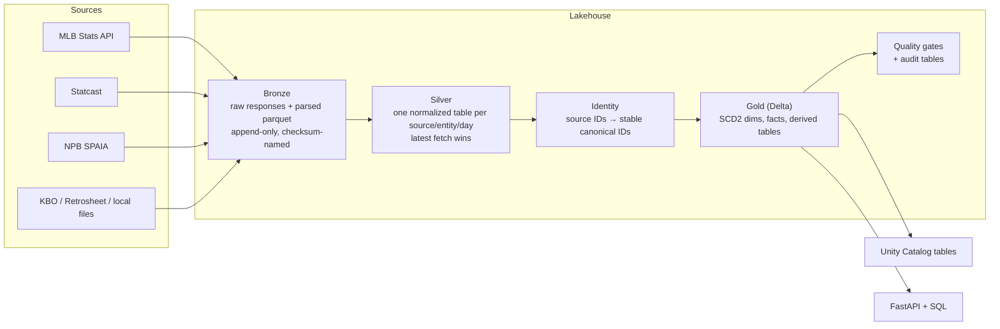

# Global Baseball Data Platform (GBDP)

A lakehouse that pulls MLB, NPB (Japan) and other leagues' data from their public feeds and turns it into one consistent, queryable model: games, rosters, players, every plate appearance and every pitch. It also produces derived analytics like season-to-date run expectancy. It runs nightly on Databricks (Delta Lake + Unity Catalog) and identically on a laptop (Parquet + DuckDB), and serves everything through a small FastAPI.

```
$ curl 'localhost:8000/run-expectancy?league=MLB&season=2025'
```

| Bases | 0 outs | 1 out | 2 outs |
|-------|-------:|------:|-------:|
| empty | 0.37 | 0.19 | 0.09 |
| 1st   | 0.68 | 0.32 | 0.23 |
| 1st & 2nd | 1.47 | 0.88 | 0.56 |
| loaded | 1.50 | 1.33 | 1.29 |

<sub>Expected runs from each base/out state to the end of the inning, computed from 933 MLB plate appearances on 2025-04-01 (one day, so small-sample noisy; a full season converges on the familiar ~0.5 for bases empty, nobody out).</sub>

## What's in it

| Source | League | What it provides |
|---|---|---|
| MLB Stats API | MLB | schedules, games and scores, rosters, transactions, player bios (height, weight, birth date, bats/throws) |
| Baseball Savant (Statcast) | MLB | every pitch: type, velocity, location, count, result; plate appearances and base/out state derived from it |
| SPAIA | NPB | schedules, games, rosters (with kana names), play-by-play, standings, player stats |
| KBO | KBO | games and scores |
| Retrosheet (local files) | MLB, historical | event files: historical play-by-play, rosters, box scores |
| Local files | Indy, LMB | box scores and rosters |

## Architecture



Each day (`dt`) flows through 16 stages: `fetch_*` → `silver_normalize` → `identity_resolve` → `gold_publish` → `quality_checks` → `audit_report` → `register_uc`. Any range of days can be re-run at any time; re-running is idempotent.

## Gold data model

| Table | Grain |
|---|---|
| `dim_league`, `dim_season` | league; league × season |
| `dim_team`, `dim_player` | SCD2: one version per change, `valid_from_dt`/`valid_to_dt`/`is_current` |
| `bridge_source_ids` | source system + source ID → canonical ID |
| `fact_game` | game (teams, score, status) |
| `fact_plate_appearance` | plate appearance: batter, pitcher, batting/fielding team, event, base/out state before and after, runs on the play, runs to end of inning |
| `fact_pitch` | pitch: type, velocity, location, count, result, linked to its plate appearance |
| `fact_roster`, `fact_transaction`, `fact_standings` | team × player × day; transaction; team × day |
| `fact_boxscore_batting`, `fact_boxscore_pitching` | player × game |
| `run_expectancy` | league × season × base state × outs, season to date |
| `feature_player_rolling_30d`, `breakout_candidates` | player × day |
| `audit_quality`, `audit_stage_runs`, `audit_pipeline_runs` | check / stage / run results |

## Design decisions worth knowing

- **Stable IDs.** Every canonical ID is a hash of a source key (`game:mlb_statsapi:778563`), so the same player, team or game gets the same ID on every run and on every machine. An earlier version mixed the date into the hash; 0 of 2,369 entities kept their ID from one day to the next.
- **History without drift.** `dim_player`/`dim_team` are rebuilt as a full SCD2 snapshot per day, which is why gold processes dates in order.
- **Re-runnable everything.** Bronze is append-only and content-addressed; silver reads only the latest fetch of a day; gold and UC writes replace exactly one `dt` partition. The nightly job re-processes the last 7 days, so late stat corrections land without manual work.
- **Schema safety.** Column types that sparse days would otherwise infer wrongly are pinned. When a table and new data still disagree, the UC publisher casts only where no value can be lost, isolates the failure to that one table, and doesn't waste retries on it.
- **Quality gates.** `row_count_min`, `uniqueness`, `referential_integrity`, `base_state_range`, `outs_range`, `pitch_coverage`, `npb_pbp_coverage` and `schema_drift` run after every gold publish. Results land in `audit_quality`, and hard failures fail the job.

## Run it locally

The pipeline run below takes about 15 seconds; most of the setup time is `pip install`.

```bash
pip install -e .
export GBDP_DATA_ROOT=./data            # PowerShell: $env:GBDP_DATA_ROOT = "./data"

# One real MLB day, fetched live: 13 games, 3,704 pitches, 933 plate appearances (~13 s)
python -m gbdp.cli run --start 2025-04-01 --end 2025-04-01 --leagues mlb \
  --stages fetch_schedules,fetch_pitches,silver_normalize,identity_resolve,gold_publish --force

python -m gbdp.cli serve                # http://127.0.0.1:8000/docs
```

Then try:

```bash
curl 'localhost:8000/games?date=2025-04-01'
curl 'localhost:8000/run-expectancy?league=MLB&season=2025'
curl -X POST localhost:8000/query -H 'Content-Type: application/json' \
  -d '{"sql": "SELECT event_type, count(*) n FROM fact_plate_appearance GROUP BY 1 ORDER BY 2 DESC"}'
```

`/query` runs read-only SQL over gold (DuckDB, confined to the gold directory). Set `GBDP_API_TOKEN` to require `Authorization: Bearer <token>` on it and on `/metrics/query` before exposing the API beyond localhost.

### API

| Endpoint | Returns |
|---|---|
| `GET /leagues`, `/teams`, `/players?query=` | dimensions (current versions) |
| `GET /games?date=&league=`, `/games/{id}` | games |
| `GET /players/{id}/stats?window=rolling_30d` | box score lines or 30-day rollups |
| `GET /run-expectancy?league=&season=` | RE24 table |
| `GET /breakout-candidates` | derived player list |
| `GET /schema` | the semantic layer: tables, columns, caveats, vocabularies, views, metrics |
| `GET /metrics`, `/metrics/{name}` | governed metric definitions |
| `POST /metrics/query` | compute metrics by dimensions (bearer token like `/query`) |
| `POST /query` | ad-hoc SQL over gold and the `v_*` views |

Every read endpoint takes `as_of=YYYY-MM-DD` to read the data as it stood on that day.

### Semantic layer

[`configs/semantic_layer.yaml`](configs/semantic_layer.yaml) is the one definition of what gold means and how every metric is computed: each table's grain, keys, columns and caveats, the code lists (event types, base states, season phases), plain views (`v_plate_appearance`, `v_team_game`, ...) and 52 metrics in six metric views (batting from plate appearances, batting and pitching from box scores, team results, Statcast pitches, run expectancy). Everything reads it:

- the API (`/metrics`) and MCP server (`list_metrics`, `describe_metric`, `compute_metric`) compile requests to SQL on local gold;
- `gbdp semantic-layer` (bundle job `gbdp-semantic-layer`; the SQL is in [docs/semantic_layer_uc.sql](docs/semantic_layer_uc.sql)) writes table and column comments, the views and `CREATE VIEW ... WITH METRICS` metric views (`mv_batting`, `mv_pitching`, `mv_team_games`, ...) to Unity Catalog for Genie and SQL users. **Not applied yet:** none of these exist in `gbdp.gold_gbdp` today, and they haven't been checked on Databricks (`--validate-in` hasn't been run). `mv_batting`, `mv_run_expectancy` and `mv_team_games` also need the gold rebuild first: production gold has no `run_expectancy_daily` table, no `fact_plate_appearance.runs_to_end_of_inning` and no `fact_game.game_type`, and it still has `SAC` rows where rebuilt gold has `SF`/`SH`. Rebuild gold, validate in a scratch schema, then apply ([docs/OPERATIONS.md](docs/OPERATIONS.md) 6b);
- the dashboard's metric datasets are compiled from it by `scripts/build_dashboard.py`.

```bash
curl -X POST localhost:8000/metrics/query -H 'Content-Type: application/json' -d '{
  "metrics": ["pa", "avg", "obp", "slg", "re24"], "dimensions": ["batter_name"],
  "filters": [{"dimension": "league_code", "value": "MLB"}], "start": "2025-04-01", "end": "2025-04-30",
  "order_by": [{"column": "pa", "direction": "desc"}], "limit": 10}'
python scripts/build_semantic_layer.py                               # regenerate the UC SQL after a YAML edit
python scripts/build_semantic_layer.py --validate-in semantic_check  # try the views in a scratch schema
```

Tests run the real identity and gold code on fixture silver and check the YAML against what it writes (every table and column, both ways), and every metric against hand-worked values.

## Production (Databricks)

`databricks.yml` is a Databricks Asset Bundle. A push to `main` runs the tests and an end-to-end pipeline smoke test in GitHub Actions, then deploys these jobs:

| Job | Purpose |
|---|---|
| `gbdp-nightly` | 04:00 UTC: yesterday plus the 7-day correction window, all leagues. Its on/off state is the `nightly_pause_status` bundle variable, so a deploy never silently re-enables it. |
| `gbdp-backfill` | any `start_date`..`end_date`, `leagues` and `stages` |
| `gbdp-check-data` | gold row counts for a date |
| `gbdp-semantic-layer` | table/column comments, `v_*` views and `mv_*` metric views from the semantic layer; run after a gold rebuild or a YAML change |

Storage is Unity Catalog Volumes per layer (`/Volumes/gbdp/{bronze,silver,gold}_gbdp/...`). Gold is Delta, and every layer is also registered as managed UC tables in `gbdp.{bronze,silver,gold}_gbdp`. See [docs/OPERATIONS.md](docs/OPERATIONS.md) for runbooks and [docs/E2E.md](docs/E2E.md) for the end-to-end walkthrough.

## Proving the data is right

Quality checks catch broken invariants. They can't tell you the numbers match reality, so two tools reconcile the platform against the leagues' own records.

**`scripts/reconcile_day.py`** runs on a local pipeline output for one day. It fetches ground truth independently: MLB boxscores and linescores, and the totals NPB's feed embeds in every event. Then it checks each layer: bronze has every entity, silver has every game with the right final score, gold rebuilds each team's plate appearances, runs and hits exactly, and the API returns what gold holds.

```bash
python -m gbdp.cli run --start 2026-06-10 --end 2026-06-10 --leagues mlb,npb --force
python scripts/reconcile_day.py 2026-06-10 --data-root ./data
```

On 2026-06-10 and 2026-09-05 (15 MLB + 6 NPB games each), every check passes:
- MLB plate appearances, runs and hits per team match the official boxscores in every game, every PA has a batter and both teams, and every pitch belongs to a PA;
- NPB runs and hits per team match the feed's totals in every game. Over all 156 NPB games in May–June, hits match in 156 and runs in 155; the one exception is a walk-off run on a wild pitch, which belongs to no PA.

Getting there found and fixed real defects: NPB counted every pitch as a plate appearance, 20% of MLB PAs had no batter, runs that scored mid-PA were dropped, and backfilled MLB rosters held the current roster instead of the historical one. Each fix has a regression test.

**`scripts/verify_lakehouse.py`** checks the live Unity Catalog tables through a SQL warehouse:

```bash
python scripts/verify_lakehouse.py --start 2026-05-13
```

It prints PASS/WARN/FAIL for:
- bronze: every key entity present for each loaded date, the HTTP status of its latest fetch, and payloads too small to be real;
- daily game, plate appearance and pitch counts, and PAs per MLB game with their team coverage;
- key uniqueness in every fact table, one current row per player, and bio fill rates;
- roster sizes, Statcast coverage in silver, and recorded quality failures;
- production gold reconciled against MLB's boxscores for sample days.

Both tools only read, so they're safe to run while jobs are running.

## Tests

```bash
pytest
```

The suite has 181 tests. Most are regression tests named after real production incidents, such as rosters duplicated ~110×, a type clash that blocked publishing, and IDs that changed daily. Each pins the fix so the bug can't come back.

## Repository layout

```
src/gbdp/
  connectors/   one module per source (fetch + parse into bronze)
  bronze/       append-only writer (raw + parsed)
  silver/       per-source normalizers
  identity/     canonical ID resolution and the source-ID bridge
  gold/         dims, facts, derived tables
  quality/      checks and audit writes
  catalog/      Unity Catalog registration
  pipeline/     stage runner, windows, retries
  serve/        FastAPI app and the gold query layer
configs/        sources and leagues
scripts/        reconcile_day.py, verify_lakehouse.py, build_dashboard.py
docs/           operations runbook, end-to-end walkthrough, UC SQL
TRD.md          the original technical requirements
```
